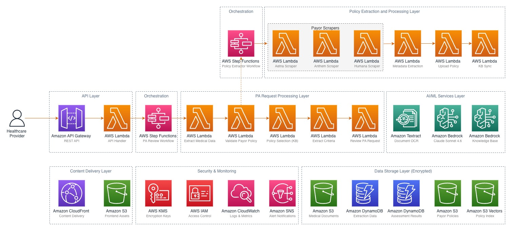

# Prior Authorization Assistant

An AI-powered system that automates prior authorization validation for healthcare providers using Amazon Bedrock, AWS Step Functions, and a React frontend. The application extracts clinical information from medical documents, matches it against payor policies, and provides detailed gap analysis with recommendations.

## Overview

Prior authorization is a utilization management process used by health insurance companies that requires healthcare providers to obtain advance approval before delivering specific services. This process is often manual, time-consuming, and error-prone.

This solution automates the workflow by:

1. Accepting prior authorization documents (PDF, FHIR JSON) through a web portal
2. Extracting medical information (CPT codes, ICD codes, payor details) using Amazon Textract and Amazon Bedrock
3. Matching requests against relevant payor policies stored in an Amazon Bedrock Knowledge Base
4. Extracting clinical criteria from matched policies
5. Reviewing medical records against policy requirements
6. Producing a detailed assessment with gap analysis and recommendations

## Architecture



The solution uses a serverless, event-driven architecture:

| Component | AWS Service | Purpose |
|-----------|-------------|---------|
| Frontend | Amazon S3 + Amazon CloudFront | React/TypeScript web application |
| API | Amazon API Gateway | REST API with rate limiting |
| Document Processing | AWS Lambda (Python 3.11) | Extract medical data from documents |
| AI/ML | Amazon Bedrock (Claude Sonnet 4.6) | Clinical analysis and policy matching |
| Document OCR | Amazon Textract | PDF text extraction |
| Policy Store | Amazon Bedrock Knowledge Base | Payor policy retrieval (RAG) |
| Orchestration | AWS Step Functions | Multi-step validation workflow |
| Document Storage | Amazon S3 | Uploaded documents and policies |
| State Management | Amazon DynamoDB | Request tracking and results |
| Encryption | AWS KMS | Customer-managed encryption keys |
| Infrastructure | AWS CDK (Python) | Infrastructure as code |

All resources follow the naming pattern `pa-assist-{resource}-{environment}`.

## Prerequisites

Before deploying this solution, ensure you have the following installed:

- [Python 3.11](https://www.python.org/downloads/) or later
- [Node.js 18.x](https://nodejs.org/) or later
- [AWS CLI v2](https://docs.aws.amazon.com/cli/latest/userguide/getting-started-install.html)
- [AWS CDK v2](https://docs.aws.amazon.com/cdk/v2/guide/getting-started.html) (`npm install -g aws-cdk`)
- [Docker](https://docs.docker.com/get-docker/) (required for Lambda bundling)
- An AWS account with permissions to create the resources listed above
- AWS CLI configured with valid credentials (`aws configure`)

### Supported AWS Regions

This solution requires Amazon Bedrock with Claude Sonnet 4.6 model access. Verify [model availability](https://docs.aws.amazon.com/bedrock/latest/userguide/models-regions.html) in your target region. The default deployment region is `us-east-1`.

### Amazon Bedrock Setup

Before deployment, you must [enable model access](https://docs.aws.amazon.com/bedrock/latest/userguide/model-access.html) for the following models in the Amazon Bedrock console:

- Anthropic Claude Sonnet 4.6 (for clinical analysis and policy matching)
- Amazon Titan Embeddings V2 (for the Knowledge Base vector store)

The CDK stack automatically creates the Amazon Bedrock Knowledge Base, S3 Vectors storage, and data source. No manual KB setup is required.

## Deployment

### 1. Clone the repository

```bash
git clone https://github.com/aws-samples/<repo-name>.git
cd <repo-name>
```

### 2. Install Python dependencies

```bash
pip install -r requirements.txt
pip install -r infrastructure/requirements.txt
```

### 3. Install Lambda layer dependencies

```bash
pip install -r layers/python-deps/requirements.txt -t layers/python-deps/python/ --upgrade
```

### 4. Bootstrap AWS CDK (first time only)

```bash
cd infrastructure
cdk bootstrap aws://<ACCOUNT_ID>/<REGION>
```

### 5. Configure deployment parameters

From the `infrastructure/` directory, edit `cdk.json` and set the context parameters:

```json
{
  "context": {
    "environment": "dev"
  }
}
```

| Parameter | Description | Required |
|-----------|-------------|----------|
| `environment` | Deployment environment (`dev`, `staging`, `prod`) | Yes (default: `dev`) |

Or set environment variables:

```bash
export ENVIRONMENT=dev
```

### 6. Deploy the stack

Still in the `infrastructure/` directory:

```bash
cdk deploy --require-approval never --outputs-file deployment-outputs.json
```

Estimated deployment time: 10-15 minutes.

On successful deployment, CDK prints the following outputs:

| Output | Description |
|--------|-------------|
| `APIEndpointOutput` | API Gateway endpoint URL |
| `FrontendURLOutput` | CloudFront distribution URL for the web app |
| `FrontendBucketOutput` | S3 bucket name for frontend assets |
| `DocumentsBucketOutput` | S3 bucket name for uploaded documents |
| `PoliciesBucketOutput` | S3 bucket name for payor policies |
| `KnowledgeBaseIdOutput` | Bedrock Knowledge Base ID (auto-created) |
| `DataSourceIdOutput` | Bedrock Data Source ID (auto-created) |

### 7. Configure the frontend

Return to the project root and create a `.env` file from the example:

```bash
cd ..
cp frontend/.env.example frontend/.env
```

Update `frontend/.env` with the `APIEndpointOutput` value from step 6:

```
REACT_APP_API_BASE_URL=https://<your-api-id>.execute-api.<region>.amazonaws.com/prod
```

### 8. Build and deploy the frontend

```bash
cd frontend
npm install
npm run build
```

Upload the build output to the frontend S3 bucket (use the `FrontendBucketOutput` value from step 6):

```bash
aws s3 sync build/ s3://<FrontendBucketOutput> --delete
```

To serve locally for development instead:

```bash
npm start
```

## Usage

1. Open the web application URL (CloudFront distribution URL from CDK outputs)
2. Upload a prior authorization document (PDF or FHIR JSON)
3. The system automatically processes the document through the Step Functions workflow:
   - Extracts medical information (CPT/ICD codes, payor, provider details)
   - Scrapes and extracts the relevant payor policies automatically
   - Syncs the policies to the Bedrock Knowledge Base
   - Selects matching policies using RAG-powered intelligent search
   - Extracts clinical criteria from the matched policies
   - Reviews the medical record against policy requirements
4. On first upload, the policy extraction and KB sync may take a few minutes. Subsequent uploads for the same payor will be faster since policies are already indexed.
5. View the results page with the detailed assessment, gap analysis, and recommendations

## Sample Data

The `samples/` directory contains synthetic prior authorization request documents for testing:

- Aetna physical therapy (PDF and FHIR JSON)
- Aetna spinal fusion (FHIR JSON)
- Anthem knee surgery (PDF and FHIR JSON)
- Humana cardiac catheterization (PDF and FHIR JSON)

Upload any of these through the web UI to test the end-to-end workflow. These documents are entirely synthetic and do not contain any real patient information.

## Cleanup

To remove all deployed resources and avoid ongoing charges:

```bash
cd infrastructure
cdk destroy --force
```

This removes all AWS resources created by the stack, including S3 buckets, DynamoDB tables, Lambda functions, and the Step Functions state machine. S3 buckets with the `autoDeleteObjects` property will have their contents removed automatically.

> **Important:** Ensure you have downloaded any data you need from S3 buckets before running cleanup.

## Security

This application follows AWS security best practices:

- All data encrypted at rest using customer-managed AWS KMS keys
- All data encrypted in transit via TLS
- IAM roles follow the principle of least privilege
- API Gateway enforces HTTPS with rate limiting and throttling
- DynamoDB tables have point-in-time recovery enabled
- CloudWatch logging enabled for audit trails
- No hardcoded credentials — all secrets managed through environment variables and CDK context

See [CONTRIBUTING](CONTRIBUTING.md) for information on reporting security issues.

## License

This library is licensed under the MIT-0 License. See the [LICENSE](LICENSE) file.
